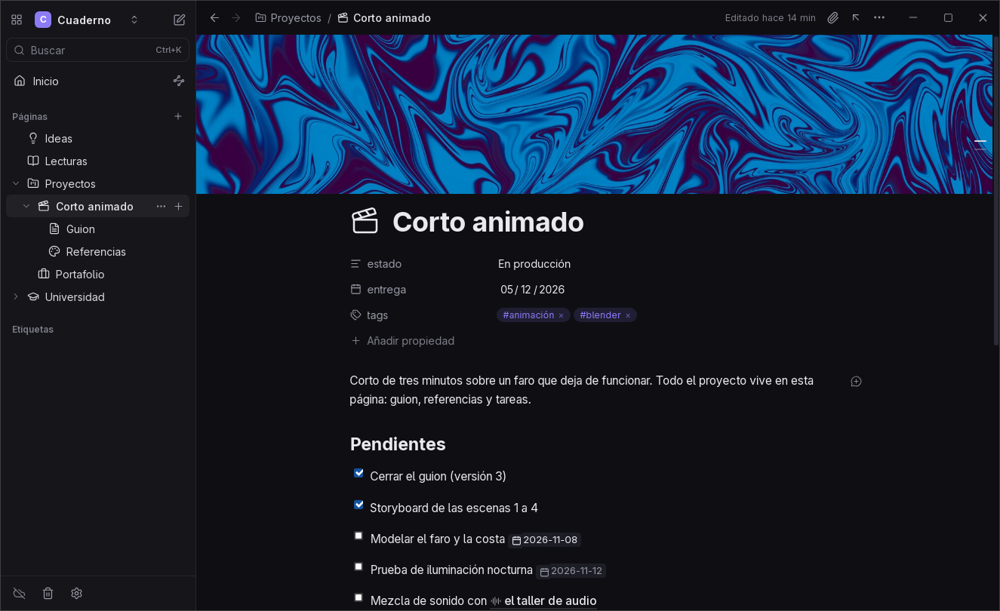

  

<h1 align="center">Onyx</h1>

  Notas con la comodidad de Notion, guardadas como archivos Markdown en tu equipo.

  <a href="../../releases/latest"><b>Descargar la última versión</b></a>
  &nbsp;·&nbsp; Windows &nbsp;·&nbsp; Linux &nbsp;·&nbsp; Android

  

## Qué es

Onyx es una app de notas para escribir rápido y organizar sin pensar en el formato. Escribes en bloques, como en Notion: títulos, listas, tareas, tablas, imágenes, código. Por debajo, cada página es un archivo `.md` normal en una carpeta tuya. No hay cuenta ni nube obligatoria, y tus notas se pueden abrir con cualquier otro editor, incluido Obsidian.

## Lo que puedes hacer

- **Escribir sin ver la sintaxis.** Usa `/` para insertar cualquier bloque, arrastra bloques para reordenarlos y cambia colores de texto y fondo.
- **Organizar en páginas y subpáginas.** Cada carpeta es una página, con iconos (más de 10.000) y portadas propias o de galerías libres.
- **Enlazar ideas.** Escribe `[[` para enlazar otra página. Al renombrar una página se actualizan todos sus enlaces, y cada página muestra quién la menciona.
- **Llevar tareas.** Las tareas pueden tener fecha y repetirse, y hay una vista con lo vencido, lo de hoy y lo próximo.
- **Armar bases de datos.** Tablas, tarjetas y listas a partir de tus notas, con filtros, orden y fórmulas. También tableros Kanban.
- **Llevar un diario.** Una nota por día, en la carpeta y con el formato que elijas, con calendario.
- **Traer lo que ya tienes.** Abre un vault de Obsidian tal cual, importa un export de Notion o clona un proyecto desde GitHub.
- **Exportar.** Una página o todo el proyecto, a HTML o PDF.

Si vienes de Obsidian, Onyx entiende el formato de varios de sus plugins más usados (Tasks, Dataview, Kanban, Bases, Templater, Iconize), así que puedes ir y volver sin perder nada.

## Instalación

Descarga el archivo de tu sistema desde [Releases](../../releases/latest):

| Sistema | Archivo | Notas |
|---|---|---|
| Windows 10 u 11 | `Onyx_<versión>_x64-setup.exe` | Si aparece SmartScreen, elige *Más información → Ejecutar de todas formas*. El instalador no está firmado con un certificado de pago. |
| Linux (x86-64) | `Onyx_<versión>_amd64.AppImage` | Dale permiso de ejecución (`chmod +x`) y ábrelo. |
| Android 8.0 o superior | `Onyx_<versión>_android-arm64.apk` | Android te pedirá permitir apps de orígenes desconocidos. |

macOS no tiene versión por ahora.

## Actualizaciones

En Windows y Linux, Onyx busca versiones nuevas al abrirse y se actualiza sola. Las actualizaciones van firmadas: la app rechaza cualquier archivo que no venga de aquí. En Android, la app te avisa cuando hay una versión nueva y abre la descarga.

---

Este repositorio solo publica los instaladores; el código fuente es privado. Si algo falla o tienes una idea, abre un [issue](../../issues).
