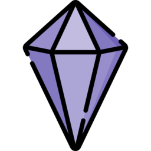
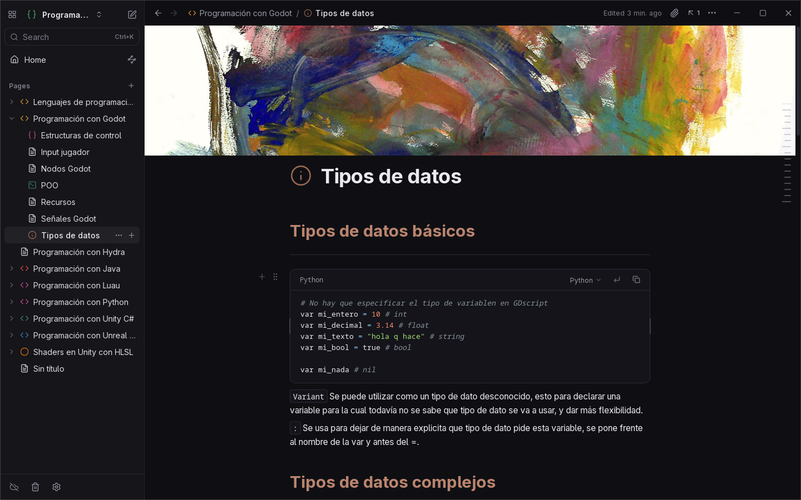
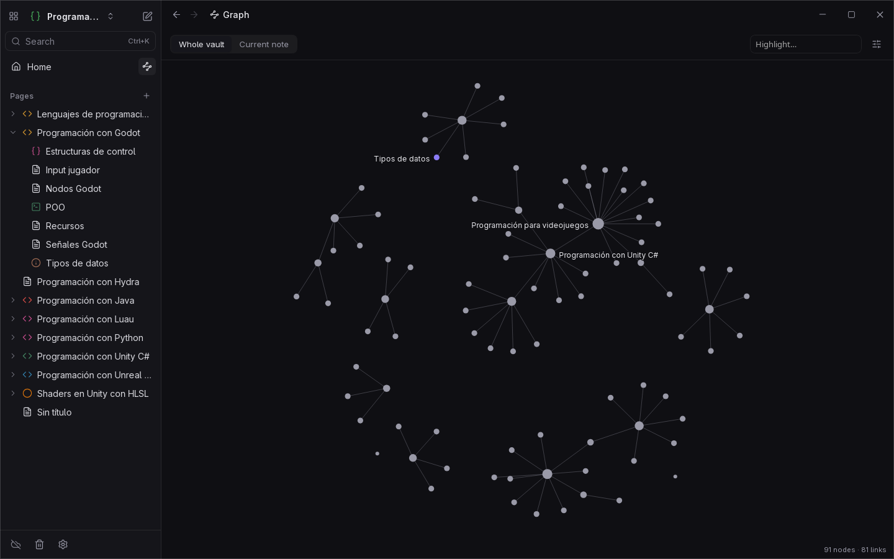
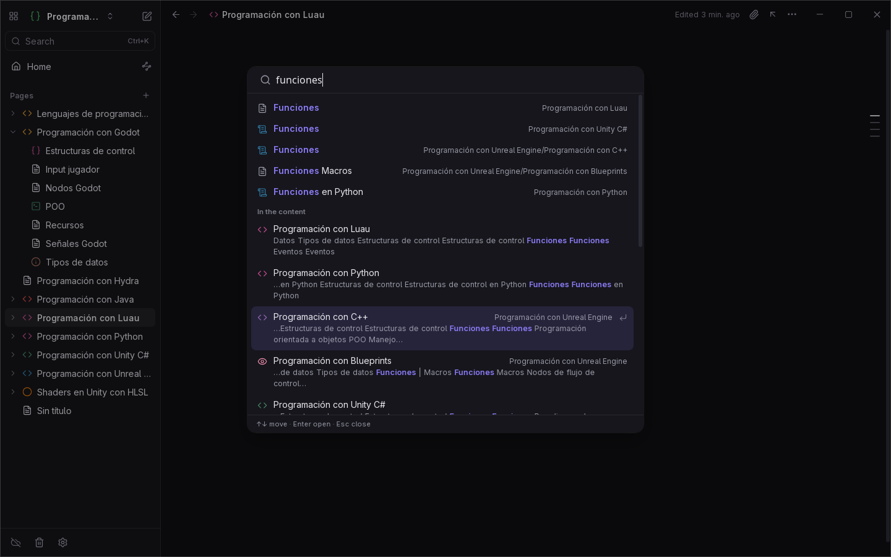

  

<h1 align="center">Onyx</h1>

  Everything that makes Notion comfortable, in notes that live on your own computer, just like Obsidian.

  
  
  

  

## Why Onyx

Notion is a pleasure to write in, but your notes live on someone else's servers. Obsidian keeps them on your computer as plain files, but getting it to feel that polished takes plugins and tweaking.

Onyx wants both. It has the editor, the pages, the databases and the little comforts of Notion, and every page is a regular `.md` file in a folder you own. No account, no mandatory cloud, nothing locked in: you can open the same folder in Obsidian or any text editor whenever you like.

<table>
  <tr>
    <td width="50%"></td>
    <td width="50%">
      <h3>See how your ideas connect</h3>
      
Link pages by typing <code>[[</code>. The graph shows your whole vault or just the notes around the one you're reading, and every page lists the ones that mention it.

    </td>
  </tr>
  <tr>
    <td width="50%">
      <h3>Find anything in a second</h3>
      
Press <kbd>Ctrl</kbd>+<kbd>K</kbd> and start typing. Onyx searches titles and the full text of every note as you type, even in large vaults.

    </td>
    <td width="50%"></td>
  </tr>
</table>

## Features

<b>Writing</b>

 

- A block editor where you never see Markdown symbols: what you type is what you get.
- Type `/` to insert any block, grouped by category, or use the floating toolbar to format a selection.
- Drag blocks to reorder them, turn one kind of block into another, duplicate or move it with the keyboard, and select several at once.
- Text and background colors, toggles, collapsible headings, callouts and side-by-side columns.
- Code blocks for more than 50 languages, with full highlighting, auto-indent and bracket closing.
- Math formulas, Mermaid diagrams and sheet music you can play.
- Paste Markdown from anywhere and it turns into formatted blocks; copy from Onyx and you get Markdown back.

<b>Organizing</b>

 

- Pages inside pages, as deep as you want. Every folder is also a page.
- More than 10,000 icons, searchable in English or Spanish and in any color, or your own images.
- Notion-style covers: colors, gradients, your own pictures or free galleries (NASA, the Met Museum, Wikimedia Commons).
- Favorites, recent pages, tags and custom sections in the sidebar.
- Several projects (vaults) and a quick switcher between them.
- A trash bin to restore deleted pages and a version history for each note.

<b>Linking</b>

 

- Link to any page with `[[`, with suggestions as you type and a preview on hover.
- Renaming a page updates every link to it across the vault.
- Each page shows its backlinks and the places that mention it without a link, ready to turn into one with a click.
- Embed a whole note, a section or a single block inside another note, always up to date.
- A global and a local graph view (<kbd>Ctrl</kbd>+<kbd>G</kbd>).

<b>Tasks, databases and planning</b>

 

- Tasks with due dates, priorities and repeats ("every week"). Completing one schedules the next.
- A view of all your tasks: overdue, today and upcoming.
- Notion-style databases made from your notes: table, cards or list, with filters, sorting, grouping and formulas. They can live on their own page or inside a note.
- Page properties (text, numbers, dates, checkboxes, lists, tags) that become database columns.
- Kanban boards on a free canvas.
- Daily notes with a calendar, organized in the folders and date format you choose.
- Templates with variables.

<b>Images, media and files</b>

 

- Drag or paste images, audio (with a small player), PDFs and video into a note.
- Paste a link and choose: plain link, bookmark card with title and description, or embed (YouTube, Vimeo, images, video).
- Attachments are sorted into folders by type with readable names, and renaming one updates every reference.
- A files panel to browse, preview, insert or delete the files of a page or the whole vault.

<b>Import, export and sync</b>

 

- Import a Notion export with its page order, subpages, colors, icons, covers and databases.
- Open an existing Obsidian vault as it is.
- Export a page or the whole project to Markdown, HTML or PDF, with or without subpages.
- Built-in sync with GitHub: connect your account, pick a private repository and Onyx keeps it in sync, with a visual helper when two devices edit the same note. No need to install Git.
- Clone a vault from GitHub on a new computer straight from the start screen.

<b>Make it yours</b>

 

- Themes (light, dark, sepia, Nord, forest and high contrast), accent color, font, font size and page width.
- Separate zoom for the page and the sidebar.
- Interface in English and Spanish.
- An optional AI assistant (<kbd>Ctrl</kbd>+<kbd>J</kbd>) to improve, fix, summarize, translate or continue your text, using Claude, a local Ollama model or any OpenAI-compatible server. It can be turned off completely.
- Plugins with an API similar to Obsidian's.

<b>Your notes stay yours</b>

 

- Every page is a plain `.md` file. The file name is the page title.
- Opening or saving a note never rewrites it. Editing a block only changes that block on disk, and anything Onyx doesn't understand is kept exactly as it was.
- Changes made with other apps show up in Onyx right away.
- Understands the formats of popular Obsidian plugins (Tasks, Dataview, Kanban, Bases, Templater, Iconize), so you can go back and forth without losing anything.

## Download

| System | Download | Notes |
|---|---|---|
| **Windows** | [Installer (.exe)](https://github.com/Amariless/Onyx-releases/releases/download/v0.2.0/Onyx_0.2.0_x64-setup.exe) | Windows 10 or 11. If SmartScreen shows up, choose *More info → Run anyway*. The installer isn't signed with a paid certificate. |
| **Linux** | [AppImage](https://github.com/Amariless/Onyx-releases/releases/download/v0.2.0/Onyx_0.2.0_amd64.AppImage) | 64-bit PCs. Make it executable (`chmod +x`) and open it. |
| **Android** | [APK](https://github.com/Amariless/Onyx-releases/releases/download/v0.2.0/Onyx_0.2.0_android-arm64.apk) | Android 8.0 or newer. Android will ask you to allow installing apps from this source. |

There's no macOS version yet. Older versions and release notes are on the [Releases](https://github.com/Amariless/Onyx-releases/releases) page.

On Windows and Linux, Onyx checks for new versions when it opens and updates itself. Updates are signed, so the app only accepts files published here. On Android, the app lets you know when there's a new version and opens the download.

## Feedback

Found a bug, have an idea or just want to say something? Each button opens a short form.

  
  
  

---

This repository only hosts the installers; the source code is private.
